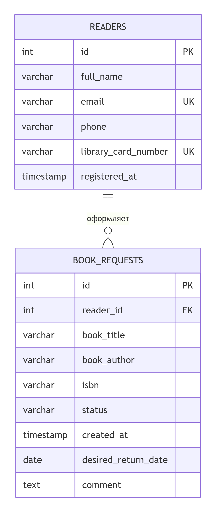

# Библиотечная информационная система

Настольное приложение на JavaFX для учёта читателей библиотеки и заявок на выдачу книг.

**Контрольная работа 1** — консольное приложение с JDBC, PostgreSQL и многослойной архитектурой.

**Контрольная работа 2** — JavaFX-клиент с графическим интерфейсом, работающий с той же БД через JDBC.

---

## Содержание

- [Возможности](#возможности)
- [Архитектура](#архитектура)
- [Технологии](#технологии)
- [Требования](#требования)
- [Установка и запуск](#установка-и-запуск)
- [Структура проекта](#структура-проекта)
- [База данных](#база-данных)
- [Бизнес-правила](#бизнес-правила)
- [Enum RequestStatus](#enum-requeststatus)
- [Функциональность JavaFX](#функциональность-javafx)
- [Экспорт в Excel](#экспорт-в-excel)
- [Сборка JAR](#сборка-jar)
- [Частые проблемы](#частые-проблемы)
- [Авторы](#авторы)

---

## Возможности

### Консольный клиент (КР №1)
- Полный CRUD для читателей и заявок
- 4 способа поиска (название книги, автор, ФИО читателя, номер билета)
- 3 фильтра (статус, диапазон дат, читатель)
- 3 сортировки через Stream API
- 12 агрегатных отчётов и 6 показателей статистики
- Экспорт в Excel через Apache POI
- Просмотр таблиц БД

### JavaFX-клиент (КР №2)
- Главное окно с боковой навигацией
- Раздел «Читатели»: таблица + CRUD + валидация
- Раздел «Заявки»: таблица + CRUD + ComboBox читателя + статусы
- Раздел «Поиск»: по названию книги / автору / ФИО / номеру билета
- Раздел «Фильтрация»: по статусу / читателю / диапазону дат
- Раздел «Сортировка»: по дате / названию / статусу (↑/↓)
- Раздел «Статистика»: 7 показателей + распределение по статусам + топ-5 книг/авторов
- Экспорт данных в `.xlsx` через FileChooser

---

## Архитектура

```
Console UI / JavaFX Controller → Service → Repository / JDBC → PostgreSQL
```

| Слой                  | Назначение                | Пакет                       |
| --------------------- | ------------------------- | --------------------------- |
| Console UI            | Консольное меню           | `ru.mirea.library.ui`       |
| JavaFX Controller     | Обработчики UI            | `ru.mirea.library.fx.controller` |
| JavaFX Util           | Утилиты UI (AlertHelper)  | `ru.mirea.library.fx.util`  |
| Service               | Бизнес-логика, валидация  | `ru.mirea.library.service`  |
| Repository            | SQL-запросы, JDBC         | `ru.mirea.library.repository` |
| Model                 | Предметные сущности       | `ru.mirea.library.model`    |
| Exception             | Собственные исключения    | `ru.mirea.library.exception` |
| Util                  | Подключение к БД, экспорт | `ru.mirea.library.util`     |

SQL-запросы находятся только в слое Repository. В UI и контроллерах нет ни одной строки SQL.

---

## Технологии

- Java 17
- Maven 3.9+
- PostgreSQL 13+
- JavaFX 21 (controls, fxml)
- JDBC (org.postgresql:postgresql)
- Apache POI (poi-ooxml) — экспорт в Excel
- JUnit 5

---

## Требования

- JDK 17 или выше
- Maven 3.9 или выше
- PostgreSQL 13 или выше
- Доступ к БД от пользователя `postgres` (или другого с правами на создание таблиц)

---

## Установка и запуск

### 1. Клонировать репозиторий

```bash
git clone https://github.com/Sofiia-cloud/library-pks.git
cd library-pks
```

### 2. Создать базу данных

```bash
createdb -U postgres library_db
```

### 3. Применить схему и тестовые данные

```cmd
chcp 65001
set PGCLIENTENCODING=UTF8
psql -U postgres -d library_db -f schema.sql
```

### 4. Настроить подключение

```cmd
copy src\main\resources\db.properties.example src\main\resources\db.properties
notepad src\main\resources\db.properties
```

Вписать свой пароль PostgreSQL:

```
db.url=jdbc:postgresql://localhost:5432/library_db
db.user=postgres
db.password=ТВОЙ_ПАРОЛЬ
```

Файл `db.properties` добавлен в `.gitignore` и не коммитится.

### 5. Запустить JavaFX-приложение

```bash
mvn clean javafx:run
```

Откроется окно с боковой навигацией. Разделы: Читатели, Заявки, Поиск, Фильтрация, Сортировка, Статистика, Экспорт.
Для экспорта нажмите «Экспорт» и выберите имя и расположение файла в диалоге сохранения. Заявки выгружаются в `.xlsx` вместе с ФИО читателей.

### 6. Запустить консольное приложение (КР №1)

```cmd
mvn clean package -DskipTests
java -Dfile.encoding=UTF-8 -jar target\library-system-1.0-SNAPSHOT.jar
```

---

## Структура проекта

```
library-pks/
├── pom.xml
├── schema.sql
├── README.md
├── mermaid.png
├── .gitignore
└── src/
    └── main/
        ├── java/ru/mirea/library/
        │   ├── Main.java                    ← JavaFX-точка входа
        │   │
        │   ├── model/
        │   │   ├── Reader.java
        │   │   ├── BookRequest.java
        │   │   └── RequestStatus.java
        │   │
        │   ├── repository/
        │   │   ├── Repository.java
        │   │   ├── ReaderRepository.java
        │   │   ├── BookRequestRepository.java
        │   │   └── ReportRepository.java
        │   │
        │   ├── service/
        │   │   ├── ReaderService.java
        │   │   ├── BookRequestService.java
        │   │   ├── SearchService.java
        │   │   ├── FilterService.java
        │   │   ├── SortService.java
        │   │   ├── StatisticService.java
        │   │   └── ReportService.java
        │   │
        │   ├── exception/
        │   │   ├── BusinessException.java
        │   │   ├── DatabaseException.java
        │   │   └── EntityNotFoundException.java
        │   │
        │   ├── fx/                          ← JavaFX-слой (КР №2)
        │   │   ├── controller/
        │   │   │   ├── MainController.java
        │   │   │   ├── ReaderController.java
        │   │   │   ├── ReaderFormController.java
        │   │   │   ├── RequestController.java
        │   │   │   ├── RequestFormController.java
        │   │   │   ├── SearchController.java
        │   │   │   ├── FilterController.java
        │   │   │   ├── SortController.java
        │   │   │   └── StatisticsController.java
        │   │   └── util/
        │   │       └── AlertHelper.java
        │   │
        │   ├── ui/                          ← консольные меню (КР №1)
        │   │   └── ...
        │   │
        │   └── util/
        │       ├── DatabaseManager.java
        │       └── ExcelExporter.java
        │
        └── resources/
            ├── css/
            │   └── styles.css
            ├── fxml/
            │   ├── main-view.fxml
            │   ├── reader-view.fxml
            │   ├── reader-form.fxml
            │   ├── request-view.fxml
            │   ├── request-form.fxml
            │   ├── search-view.fxml
            │   ├── filter-view.fxml
            │   ├── sort-view.fxml
            │   └── statistics-view.fxml
            ├── db.properties.example
            └── db.properties          ← не коммитится
```

---

## База данных

### ER-диаграмма



### Схема

`readers` — читатели библиотеки:

| Колонка             | Тип          | Ограничения             |
| ------------------- | ------------ | ----------------------- |
| id                  | SERIAL       | PRIMARY KEY             |
| full_name           | VARCHAR(150) | NOT NULL                |
| email               | VARCHAR(150) | NOT NULL, UNIQUE        |
| phone               | VARCHAR(30)  |                         |
| library_card_number | VARCHAR(30)  | NOT NULL, UNIQUE        |
| registered_at       | TIMESTAMP    | NOT NULL, DEFAULT NOW() |

`book_requests` — заявки на выдачу книги:

| Колонка             | Тип          | Ограничения                                                           |
| ------------------- | ------------ | --------------------------------------------------------------------- |
| id                  | SERIAL       | PRIMARY KEY                                                           |
| reader_id           | INTEGER      | NOT NULL, FOREIGN KEY → readers(id) ON DELETE RESTRICT                |
| book_title          | VARCHAR(200) | NOT NULL                                                              |
| book_author         | VARCHAR(150) | NOT NULL                                                              |
| isbn                | VARCHAR(20)  |                                                                       |
| status              | VARCHAR(20)  | NOT NULL, CHECK (CREATED/APPROVED/ISSUED/RETURNED/CANCELLED/REJECTED) |
| created_at          | TIMESTAMP    | NOT NULL, DEFAULT NOW()                                               |
| desired_return_date | DATE         |                                                                       |
| comment             | TEXT         |                                                                       |

### Связь

`book_requests.reader_id → readers.id` — many-to-one, `ON DELETE RESTRICT`.

### Тестовые данные

- 5 читателей
- 12 заявок
- 6 различных статусов

---

## Бизнес-правила

| #   | Правило                                      | Где реализовано                                    |
| --- | -------------------------------------------- | -------------------------------------------------- |
| 1   | ФИО читателя обязательно                     | ReaderService.create                               |
| 2   | Email по regex, обязателен, уникален         | ReaderService.validateEmail                        |
| 3   | Номер билета LIB-XXXX, обязателен, уникален  | ReaderService.validateCard                         |
| 4   | Телефон по regex (если указан)               | ReaderService.validatePhone                        |
| 5   | Нельзя удалить читателя с активными заявками | ReaderService.delete                               |
| 6   | Название книги обязательно                   | BookRequestService.create                          |
| 7   | Автор книги обязателен                       | BookRequestService.create                          |
| 8   | Читатель должен существовать                 | BookRequestService через ReaderService.existsById  |
| 9   | Дата возврата не в прошлом                   | BookRequestService.create                          |
| 10  | Запрещены недопустимые переходы статусов     | RequestStatus.canTransitionTo                      |
| 11  | Нельзя удалить заявку в статусе ISSUED       | BookRequestService.delete                          |

---

## Enum RequestStatus

```java
public enum RequestStatus {
    CREATED,    // создана
    APPROVED,   // одобрена
    ISSUED,     // выдана
    RETURNED,   // возвращена
    CANCELLED,  // отменена
    REJECTED;   // отклонена
}
```

Разрешённые переходы (`canTransitionTo`):

| Из                            | В                             |
| ----------------------------- | ----------------------------- |
| CREATED                       | APPROVED, CANCELLED, REJECTED |
| APPROVED                      | ISSUED, CANCELLED             |
| ISSUED                        | RETURNED                      |
| RETURNED, CANCELLED, REJECTED | — (терминальные)              |

---

## Функциональность JavaFX

Главное окно — боковая панель с 7 кнопками навигации. Экраны подгружаются в `contentPane`.

### Читатели
- Таблица: ID, ФИО, Email, Телефон, Билет, Регистрация
- CRUD + подтверждение удаления
- Валидация ФИО / email / телефона / билета
- Запрет удаления при активных заявках

### Заявки
- Таблица: ID, Читатель, Книга, Автор, ISBN, Статус, Создана, Вернуть до
- CRUD + ComboBox для выбора читателя
- ComboBox для выбора статуса при редактировании
- DatePicker для даты возврата
- Проверка переходов статусов

### Поиск
- Выбор типа: название книги / автор / ФИО читателя / номер билета
- Поле ввода + кнопка «Найти»
- Таблица результатов

### Фильтрация
- По статусу (ComboBox)
- По читателю (ComboBox)
- По диапазону дат создания (два DatePicker)
- Кнопка «Сбросить все фильтры»

### Сортировка
- Поле: дата / название / статус
- Направление: ↑ / ↓
- Сортировка через `Stream.sorted()` в `SortService`

### Статистика
- 7 показателей: всего читателей, всего заявок, активных, возвращённых, отменённых/отклонённых, за 30 дней, среднее на читателя
- Распределение по статусам с процентами
- Топ-5 книг
- Топ-5 авторов

### Экспорт
- Кнопка «Экспорт» открывает `FileChooser` и сохраняет все заявки с данными читателя в `.xlsx` через Apache POI.
- Файл сохраняется через `FileChooser`

---

## Экспорт в Excel

Файл `library_requests.xlsx` — экспорт заявок с JOIN читателей.

Колонки: ID заявки, ФИО читателя, Название книги, Автор, ISBN, Статус, Создана, Вернуть до, Комментарий.

---

## Сборка JAR

```bash
mvn clean package -DskipTests
```

Создаётся `target/library-system-1.0-SNAPSHOT.jar` со всеми зависимостями.

Запуск консольного клиента:

```cmd
java -Dfile.encoding=UTF-8 -jar target\library-system-1.0-SNAPSHOT.jar
```

JavaFX-клиент запускается через:

```bash
mvn javafx:run
```

---

## Частые проблемы

### `psql` не распознаётся

Добавь `bin` PostgreSQL в PATH:

```cmd
set PATH=C:\Program Files\PostgreSQL\13\bin;%PATH%
```

### Кириллица в psql

```cmd
chcp 65001
set PGCLIENTENCODING=UTF8
```

### `mvn` не распознаётся

Добавь `C:\tools\apache-maven-3.9.9\bin` в `Path`.

### `db.properties` не найден в classpath

```cmd
copy src\main\resources\db.properties.example src\main\resources\db.properties
```

### `password authentication failed for user "postgres"`

Неверный пароль в `db.properties`.

### JavaFX не запускается: `JavaFX runtime components are missing`

Используй `mvn javafx:run`, а не `java -jar` (fat JAR с JavaFX не работает напрямую без модулей).

---

## Авторы

Команда из 4 человек, группа ЭФБО-02-24, РТУ МИРЭА

- Участник 1 (Семенов Тихон): инфраструктура JavaFX, Reader UI
- Участник 2 (Иванова Валерия): BookRequest UI, CRUD, статусы, ComboBox читателей
- Участник 3 (Лукьянов Антон): поиск, фильтрация, сортировка, статистика
- Участник 4 (Головушкина София): экспорт, интеграция, README, CSS-полировка
